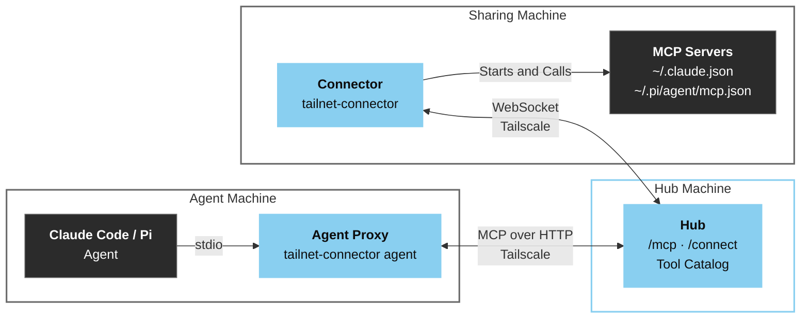

<div align="center">

<h1>Tailnet Connector</h1>

<b>Your MCP servers, on every machine in your tailnet.</b>

Share the MCP servers on each of your machines with Claude Code and Pi agents on any other machine in your Tailscale network.

<br />

[](https://github.com/marioparaschiv/tailnet-connector/stargazers)
[](https://github.com/marioparaschiv/tailnet-connector/releases)
[](https://github.com/marioparaschiv/tailnet-connector/actions/workflows/ci.yml)

**[Setup](#setup)** · [Configuration](#configuration) · [Architecture](#architecture)

</div>

## Contents

- **For Users:** [What Is Tailnet Connector?](#what-is-tailnet-connector) · [Features](#features) · [Setup](#setup) · [Configuration](#configuration)
- **For Developers:** [Architecture](#architecture) · [Developing](#developing)

## For Users

### What Is Tailnet Connector?

Say your laptop runs a browser automation server and your desktop runs a database server. An agent on either machine, or on a third one, can call the tools of both.

One binary plays three roles, picked by the command that starts it:

| Role        | Runs on                                    | Job                                                                                       |
| ----------- | ------------------------------------------ | ----------------------------------------------------------------------------------------- |
| Hub         | One machine                                | Collects the tools every connector registers and serves them to agents.                   |
| Connector   | Each machine that shares MCP servers       | Reads the servers in `~/.claude.json` and Pi's `~/.pi/agent/mcp.json` and registers them. |
| Agent proxy | Inside Claude Code or Pi, as a stdio server | Connects the agent to the hub.                                                            |

Agents see each remote tool as `<machine>__<service>__<tool>`, such as `laptop__browser__screenshot`.

All traffic goes over Tailscale. The hub listens only on its Tailscale address, so the public internet can't reach it.

### Features

| Feature                 | Description                                                                                         |
| ----------------------- | --------------------------------------------------------------------------------------------------- |
| No duplicates           | If an agent already has a server configured locally, the hub leaves its own copy out.               |
| Live config             | Edits to `~/.claude.json` or Pi's `mcp.json` apply without a restart.                               |
| Lazy servers            | Each shared server starts on its first call and stops after five minutes without calls.             |
| Availability checks     | A server can be shared only while a service it depends on accepts connections.                      |
| Pi sign-ins             | http servers from Pi reuse the OAuth tokens Pi stored, and the connector refreshes them itself.     |
| Reconnects after sleep  | A connector reconnects within a second of its machine waking up.                                    |
| Background service      | `install` sets the connector or hub up as a systemd user service, a LaunchAgent or a scheduled task. |

### Setup

Requirements: Tailscale, signed in on every machine; Rust through `rustup`, which fetches the pinned toolchain on the first build; and Claude Code or Pi on each machine that runs agents.

1. Build the binary on each machine and put `target/release/tailnet-connector` on your `PATH`:

    ```sh
    cargo build --release
    ```

2. Pick one machine as the hub and start it:

    ```sh
    tailnet-connector hub
    ```

    It prints its addresses. The rest of this guide calls `http://100.x.y.z:8790` the hub URL.

    ```
    tailnet MCP listening on http://100.x.y.z:8790/mcp
    connectors attach at ws://100.x.y.z:8790/connect
    ```

3. Start a connector on every machine whose servers you want to share, the hub's machine included if it has any:

    ```sh
    TAILNET_URL=http://100.x.y.z:8790 tailnet-connector
    ```

    It shares every server under `mcpServers` in `~/.claude.json` and in Pi's `~/.pi/agent/mcp.json`. A missing file counts as no servers. If both files define a server with the same name, the Pi one wins.

4. On each machine that runs an agent, add this entry to `mcpServers` in `~/.claude.json`:

    ```json
    "tailnet": {
      "type": "stdio",
      "command": "tailnet-connector",
      "args": ["agent"],
      "env": { "TAILNET_URL": "http://100.x.y.z:8790" }
    }
    ```

    For Pi, add the same entry to `~/.pi/agent/mcp.json`, or run:

    ```sh
    pi mcp add tailnet --env TAILNET_URL=http://100.x.y.z:8790 -- tailnet-connector agent
    ```

    The proxy spots Pi through the `PI_CODING_AGENT` variable Pi sets, then reads Pi's config instead of Claude Code's to find the servers the agent already has. Connectors skip this `tailnet` entry rather than share it.

5. Start Claude Code or Pi and ask the agent to call `list_machines`. It lists every machine on the network and the services each one shares.

### Configuration

#### Pi Entries

The connector reads Pi's entries the way Pi does:

- `type` is optional, and `streamable-http` means `http`.
- A leading `~/` in `command`, `args` or `cwd` is the home directory.
- Servers with `"enabled": false` aren't shared.
- `${VAR}` and `!command` values aren't expanded.

#### Pi Sign-ins

An http server from Pi's `mcp.json` with no `Authorization` header uses the OAuth sign-in Pi saved in `mcp-auth.json`. Sign in once with `pi mcp login <server>` on the connector's machine.

- The connector refreshes an expiring or rejected token and saves the new one for Pi.
- It takes the same lock files as Pi, so the two never refresh one token at once. Whichever comes second waits and uses the new token.
- When a refresh fails, the connector logs it. Sign in again with `pi mcp login`.
- Client secrets under `oauth` in `mcp.json` aren't used.

#### Availability Checks

To share a server only while a dependency accepts connections, create `~/.config/tailnet/checks.json`:

```json
{
  "vphone": { "tcp": "vm.local:8080" },
  "my-app": { "unixSocket": "~/.my-app/sock" }
}
```

- Each key is a server name from `mcpServers`.
- Checks run every ten seconds. One passes if the connection is accepted within one second.
- A server without a check is always shared.

#### Background Service

`install` runs the connector or the hub as a service of the current user. It starts at login and restarts after it exits, a minute later on Linux and Windows. The service runs the binary from where it is at install time, so move it somewhere permanent first.

```sh
tailnet-connector install --url http://100.x.y.z:8790   # the connector
tailnet-connector install hub                           # the hub
```

| Platform | Service                                    | Logs                                                                                       |
| -------- | ------------------------------------------ | ------------------------------------------------------------------------------------------ |
| Linux    | systemd user service                       | `journalctl --user -u tailnet-connector` or `-u tailnet-connector-hub`                     |
| macOS    | LaunchAgent                                | `~/Library/Logs/tailnet-connector/connector.log` and `hub.log`                             |
| Windows  | Scheduled task, connector only             | `%LOCALAPPDATA%\tailnet-connector\connector.log`                                           |

- The service keeps the `PATH` of the shell that ran `install`. The connector also gets `TAILNET_URL` from `--url`.
- Running `install` again replaces the service.
- On Linux, a user service only runs while you're logged in. Run `loginctl enable-linger` to keep the hub up after you log out.
- To remove it, run `tailnet-connector uninstall`, or `tailnet-connector uninstall hub` for the hub.

#### Windows

The Windows executable is cross-compiled on Linux.

1. Install the cross-compiler on Linux:

    ```sh
    sudo apt-get install -y gcc-mingw-w64-x86-64
    ```

2. Build it:

    ```sh
    cargo build --release --target x86_64-pc-windows-gnu
    ```

3. Copy `target/x86_64-pc-windows-gnu/release/tailnet-connector.exe` to a permanent folder on the Windows machine. The task runs it from there.

4. From that folder, install it. In cmd:

    ```bat
    start /wait tailnet-connector install --url http://100.x.y.z:8790
    ```

    In PowerShell:

    ```powershell
    Start-Process -Wait .\tailnet-connector -ArgumentList 'install','--url','http://100.x.y.z:8790'
    ```

The executable has no console, so without `start /wait` or `Start-Process -Wait` the prompt comes back before the output shows up.

The scheduled task starts the connector at each sign-in and restarts it a minute after a crash. It runs with your user environment, so `install` also sets the user variables `TAILNET_URL` and `TAILNET_LOG`. `start /wait tailnet-connector uninstall` removes the task and both variables.

#### Environment Variables

Everything is configured through environment variables. Only `TAILNET_URL` is required.

Connector and agent proxy:

| Variable                | Default                                              | Description                                                                 |
| ----------------------- | ---------------------------------------------------- | --------------------------------------------------------------------------- |
| `TAILNET_URL`           | None                                                 | The hub URL. Only `http://` and `ws://`, since TLS isn't supported.         |
| `TAILNET_MACHINE`       | The hostname in lowercase, without a `.local` suffix | The machine name used in tool names.                                        |
| `TAILNET_IDLE_SECONDS`  | `300`                                                | Seconds without calls before a server stops.                                |
| `CLAUDE_CONFIG`         | `~/.claude.json`                                     | The Claude Code file `mcpServers` is read from.                             |
| `PI_CODING_AGENT_DIR`   | `~/.pi/agent`                                        | Pi's agent directory, whose `mcp.json` is read.                             |
| `TAILNET_CHECKS`        | `~/.config/tailnet/checks.json`                      | The availability checks file.                                               |
| `TAILNET_CHECK_SECONDS` | `10`                                                 | Seconds between availability checks.                                        |
| `TAILNET_LOG`           | None                                                 | Windows only. The log file, since the executable has no console.            |

Hub:

| Variable                     | Default                         | Description                                                        |
| ---------------------------- | ------------------------------- | ------------------------------------------------------------------ |
| `TAILNET_MCP_HOST`           | The output of `tailscale ip -4` | The address the hub listens on.                                    |
| `TAILNET_MCP_PORT`           | `8790`                          | The port the hub listens on.                                       |
| `TAILNET_MCP_NOTIFY_SECONDS` | `300`                           | Seconds between telling agents their tools changed. Minimum `5`.   |

## For Developers

### Architecture

1. Each connector reads its machine's MCP config and registers the available servers' tools with the hub over a WebSocket on `/connect`.
2. The hub merges every connector's tools into one catalog, named `<machine>__<service>__<tool>`.
3. An agent's proxy opens an MCP session on the hub's `/mcp`, sending the servers the agent already has so the hub can leave them out.
4. A tool call goes from the agent through the proxy and the hub to the connector that owns it, which starts the server if needed and sends the result back.



#### Layout

| Path                                   | What it is                                                                  |
| -------------------------------------- | --------------------------------------------------------------------------- |
| `src/main.rs`                          | Picks the hub, connector or agent role.                                     |
| `src/connector.rs`, `src/services.rs`  | The connector: registration and server lifecycle.                           |
| `src/hub_server/`                      | The hub: `/connect` for connectors, `/mcp` for agents, and the tool catalog. |
| `src/agent.rs`, `src/known_servers.rs` | The agent proxy and duplicate filtering.                                    |
| `src/pi_config.rs`                     | Reading Pi's `mcp.json` files.                                              |
| `src/pi_auth.rs`, `src/pi_auth/`       | Pi's OAuth sign-ins: tokens, refreshes and Pi's lock files.                 |
| `src/checks.rs`                        | Availability checks.                                                        |
| `src/install.rs`, `src/install/`       | `install` and `uninstall`: the background service or the scheduled task.   |
| `examples/echo-server.rs`              | A minimal MCP server for the test suite.                                    |

### Developing

Run the same checks as CI before you push:

```sh
cargo fmt --check
cargo clippy --all-targets -- -D warnings
cargo clippy --all-targets --target x86_64-pc-windows-gnu -- -D warnings
cargo test
```

The Windows lint step needs the cross-compiler from [Windows](#windows).
